# Hi there

I'm **Felippe** ([unchain0](https://github.com/unchain0)). I work on corporate finance and accounting automation (Power Platform, Excel, data pipelines) and build side systems in Rust, Go, TypeScript, and Python.

Daily driver is Linux (Arch / Omarchy, Hyprland). I self-host with Coolify and Docker, ship web apps on Vercel, and lean hard on AI coding agents plus GitHub Actions for the boring parts.

<picture>
  <source
    media="(prefers-color-scheme: dark)"
    srcset="https://raw.githubusercontent.com/unchain0/unchain0/output/github-contribution-grid-snake-dark.svg"
  />
  <source
    media="(prefers-color-scheme: light)"
    srcset="https://raw.githubusercontent.com/unchain0/unchain0/output/github-contribution-grid-snake.svg"
  />
  
</picture>

## Profile

[](https://skillicons.dev)

---

### Github




---

### Projects

Public repos I'm actively shipping or maintaining:

- **[flashcards-generator](https://github.com/unchain0/flashcards-generator)** — Rust. Anki cloze flashcards from PDF and PPTX.
- **[sistema-ferias](https://github.com/unchain0/sistema-ferias)** — TypeScript / Next.js. Vacation control with a financial-impact dashboard ([live](https://sistema-ferias.vercel.app)).
- **[hourglass-rejections-rpa](https://github.com/unchain0/hourglass-rejections-rpa)** — Go. Watches Hourglass rejections and notifies via Telegram.
- **[hermes-obsidian](https://github.com/unchain0/hermes-obsidian)** — Python / Ansible. Hermes Agent + Obsidian vault on a Coolify VPS, with encrypted backups.
- **[habitica-levelup](https://github.com/unchain0/habitica-levelup)** — Python. CLI bot that farms Habitica XP under Docker.
- **[youtube-summary](https://github.com/unchain0/youtube-summary)** — Python. Channel transcripts + RAG Q&A (Together embeddings, Groq chat).
- **[food-recipe-analyzer](https://github.com/unchain0/food-recipe-analyzer)** — JavaScript. Mobile web app: camera food analysis and recipes via Groq Vision/TTS.
- **[FIFA-23](https://github.com/unchain0/FIFA-23)** — Python / Streamlit. Clean FIFA 23 player dataset and interactive dashboard.

Open-source contributions:

- **[Upload-Assistant](https://github.com/unchain0/Upload-Assistant)** — fork of Wastaken's Upload-Assistant with extra media workflows.
- **[upbrr](https://github.com/unchain0/upbrr)** — guided private-tracker upload prep ([upbrr.com](https://upbrr.com/)), based on [autobrr/upbrr](https://github.com/autobrr/upbrr).

---

### Wakatime

<!--START_SECTION:waka-->


**I'm an Early 🐤** 

```text
🌞 Morning                3934 commits        ████████░░░░░░░░░░░░░░░░░   30.43 % 
🌆 Daytime                4277 commits        ████████░░░░░░░░░░░░░░░░░   33.09 % 
🌃 Evening                3490 commits        ███████░░░░░░░░░░░░░░░░░░   27.00 % 
🌙 Night                  1226 commits        ██░░░░░░░░░░░░░░░░░░░░░░░   09.48 % 
```
📅 **I'm Most Productive on Friday** 

```text
Monday                   1916 commits        ████░░░░░░░░░░░░░░░░░░░░░   14.82 % 
Tuesday                  1807 commits        ███░░░░░░░░░░░░░░░░░░░░░░   13.98 % 
Wednesday                2055 commits        ████░░░░░░░░░░░░░░░░░░░░░   15.90 % 
Thursday                 1543 commits        ███░░░░░░░░░░░░░░░░░░░░░░   11.94 % 
Friday                   2851 commits        ██████░░░░░░░░░░░░░░░░░░░   22.05 % 
Saturday                 1329 commits        ███░░░░░░░░░░░░░░░░░░░░░░   10.28 % 
Sunday                   1426 commits        ███░░░░░░░░░░░░░░░░░░░░░░   11.03 % 
```


📊 **This Week I Spent My Time On** 

```text
🕑︎ Time Zone: America/Sao_Paulo

💬 Programming Languages: 
No Activity Tracked This Week

🔥 Editors: 
Codex Vscode             0 secs              █████████████████████████   100.00 % 

🐱‍💻 Projects: 
No Activity Tracked This Week

💻 Operating System: 
No Activity Tracked This Week
```

🤖 **AI Coding This Week** 

```text
No AI Coding Activity Tracked This Week
```

**I Mostly Code in Python** 

```text
Python                   12 repos            ███████████░░░░░░░░░░░░░░   42.86 % 
Rust                     4 repos             ████░░░░░░░░░░░░░░░░░░░░░   14.29 % 
TypeScript               3 repos             ███░░░░░░░░░░░░░░░░░░░░░░   10.71 % 
PHP                      2 repos             ██░░░░░░░░░░░░░░░░░░░░░░░   07.14 % 
Java                     1 repo              █░░░░░░░░░░░░░░░░░░░░░░░░   03.57 % 
```


**Timeline**


 Last Updated on 10/10/2026 22:00:51 UTC
<!--END_SECTION:waka-->
