# Hi there

I'm **Felippe** ([unchain0](https://github.com/unchain0)). I work on corporate finance and accounting automation (Power Platform, Excel, data pipelines) and build side systems in Rust, Go, TypeScript, and Python.

Daily driver is Linux (Arch / Omarchy, Hyprland). I self-host with Coolify and Docker, ship web apps on Vercel, and lean hard on AI coding agents plus GitHub Actions for the boring parts.

<picture>
  <source
    media="(prefers-color-scheme: dark)"
    srcset="https://raw.githubusercontent.com/unchain0/unchain0/output/github-contribution-grid-snake-dark.svg"
  />
  <source
    media="(prefers-color-scheme: light)"
    srcset="https://raw.githubusercontent.com/unchain0/unchain0/output/github-contribution-grid-snake.svg"
  />
  
</picture>

## Profile

---

### Github

---

### Projects

Public repos I'm actively shipping or maintaining:

- **[flashcards-generator](https://github.com/unchain0/flashcards-generator)** — Rust. Anki cloze flashcards from PDF and PPTX.
- **[sistema-ferias](https://github.com/unchain0/sistema-ferias)** — TypeScript / Next.js. Vacation control with a financial-impact dashboard ([live](https://sistema-ferias.vercel.app)).
- **[hourglass-rejections-rpa](https://github.com/unchain0/hourglass-rejections-rpa)** — Go. Watches Hourglass rejections and notifies via Telegram.
- **[hermes-obsidian](https://github.com/unchain0/hermes-obsidian)** — Python / Ansible. Hermes Agent + Obsidian vault on a Coolify VPS, with encrypted backups.
- **[habitica-levelup](https://github.com/unchain0/habitica-levelup)** — Python. CLI bot that farms Habitica XP under Docker.
- **[youtube-summary](https://github.com/unchain0/youtube-summary)** — Python. Channel transcripts + RAG Q&A (Together embeddings, Groq chat).
- **[food-recipe-analyzer](https://github.com/unchain0/food-recipe-analyzer)** — JavaScript. Mobile web app: camera food analysis and recipes via Groq Vision/TTS.
- **[FIFA-23](https://github.com/unchain0/FIFA-23)** — Python / Streamlit. Clean FIFA 23 player dataset and interactive dashboard.

Open-source contributions:

- **[Upload-Assistant](https://github.com/unchain0/Upload-Assistant)** — fork of Wastaken's Upload-Assistant with extra media workflows.
- **[upbrr](https://github.com/unchain0/upbrr)** — guided private-tracker upload prep ([upbrr.com](https://upbrr.com/)), based on [autobrr/upbrr](https://github.com/autobrr/upbrr).

---

### Wakatime

